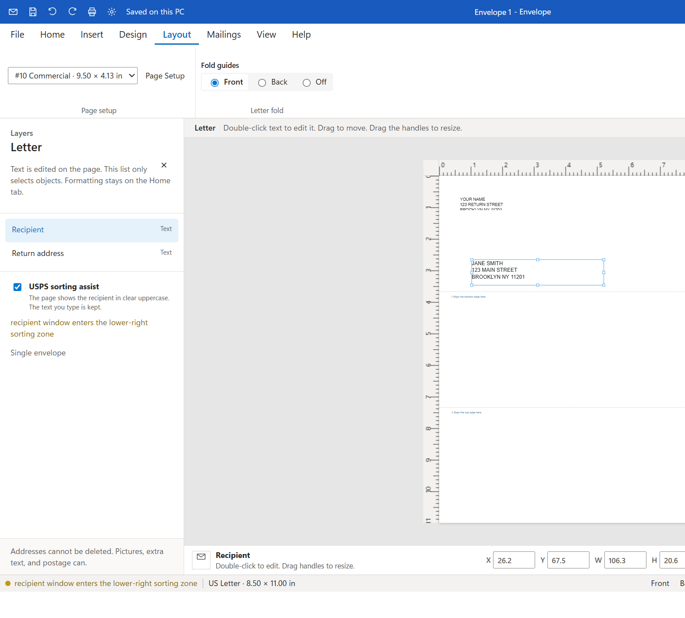

# Envelope Studio

Design envelopes and the letters that go inside them. A regular envelope prints as the envelope. A one-window or two-window envelope prints the letter at actual size, so the address shows through the window.

  

Return and recipient text stay linked, so the same address can be edited on the letter or on the envelope front. Postage is placed from a stamp PDF: keep the barcode crop, or take the whole stamp, mark and all. Fold guides mark the letter. On the envelope back, a seal-flap guide shows where text and artwork sit.

  

  

Portable app for Windows 10 or later. No installer. In the print dialog, choose Actual size and turn off headers and footers.

The two guides on the letter are the fold. Line 1 meets the bottom edge. Line 2 meets the top edge. Choose Front, Back, or Off on the Layout tab.
